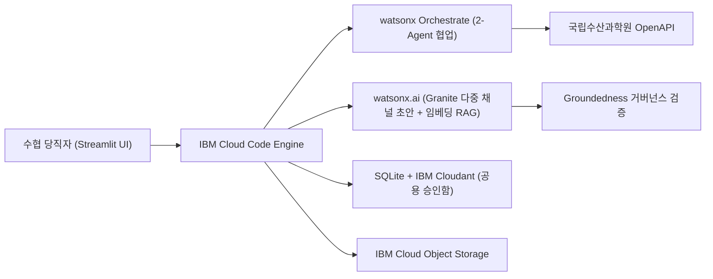

# 수협 적조 안내 갱신 에이전트

IBM watsonx 실무교육 팀 프로젝트입니다. 수협 당직자가 해역, 기준시각(KST), 직전 승인본, 질문을 입력하면 공식 발표와 승인본을 비교해 `유지`, `갱신 필요`, `확인 필요`를 판정합니다. 여수 가막만 적조특보와 정부 위기경보를 각각 확인하고, 변경이 확인되면 근거를 붙인 초안을 모의 승인함에 저장합니다.

## 1. 로컬에서 시작하기

Python 3.12 이상과 [uv](https://docs.astral.sh/uv/)가 필요합니다. 보관 발표를 쓰는 기본 시연은 API 키 없이 실행할 수 있습니다.

```sh
git clone https://github.com/Ki-Wizard/IBM-watsonx-.git
cd IBM-watsonx-
uv sync
uv run streamlit run app.py --server.address 127.0.0.1
```

브라우저에서 [Streamlit 화면](http://127.0.0.1:8501)을 엽니다. 기본 승인함은 `data/local/gamak.sqlite3`이고 `GAMAK_DB_PATH`로 위치를 지정할 수 있습니다. **새 데모 시작**은 기본 DB 옆의 `<DB 파일명>-demos/`에 빈 승인함을 만들며, **열린 승인함**에서 이전 데모로 돌아갈 수 있습니다.

## 2. 가막만 시연

1. 사이드바에서 **새 데모 시작**을 누릅니다. **과거 승인본 미리보기**에서 2025년 8월 26일 가상 승인본을 확인합니다.
2. **두 기준시각 비교**를 누릅니다. 같은 질문과 승인본으로 8월 26일 16:30은 `유지`, 8월 29일 16:30은 `갱신 필요`로 판정됩니다. 비교는 조회 전용입니다.
3. 예시 질문에서 시점 B를 골라 **예시 불러오기**를 누른 뒤 **판단 요청**을 실행합니다. 가막만 적조주의보(14:00)와 정부 위기경보 경계(16:00)의 근거를 각각 확인합니다. 같은 요청을 다시 실행하면 승인함이 `0 → 1 → 1`이고 초안 ID가 유지됩니다.
4. **승인함 · 검토 이력**에서 초안의 공식 근거와 재사용 기록을 확인하고, 담당자와 메모를 입력해 승인 또는 반려합니다.
5. **가막만 특보 해제 · 9월 26일** 예시를 불러오고 **판단 요청**을 누릅니다. 적조정보 API가 연결된 경우 국립수산과학원 적조속보에서 가막만 해제 근거를, 해양수산부 발표에서 정부 위기경보 주의 하향 근거를 확인합니다.

[전체 시연 순서와 검증 기록](docs/rehearsal.md)

## 3. IBM watsonx와 적조정보 연결

### IBM watsonx Orchestrate

`.env.example`을 `.env`로 복사한 뒤 교육 환경의 `WXO_ENDPOINT_URL`, `WXO_API_KEY`를 채우고 `GAMAK_MODE=watsonx`를 설정합니다. 별도 환경 파일을 쓰는 경우 `GAMAK_ENV_FILE`에 그 경로를 지정합니다.

Orchestrate ADK CLI에서 교육 환경을 활성화하고 저장소 루트에서 PowerShell 7로 다음 명령을 실행합니다.

```powershell
./watsonx/deploy-collaboration.ps1
```

당직 지원 에이전트 `kiw_gamak_supervisor`가 근거 조사 에이전트 `kiw_gamak_research`에 조사를 위임합니다. 백엔드는 대화 이력의 위임, 공식 발췌 검색 및 경보별 인용을 검증합니다. 화면은 **IBM 협업 · 원문 검색 확인**, **IBM 협업 결과 재사용**, **로컬 재현** 중 실제 실행 경로를 표시합니다. 검증에 실패하면 한 번 재시도한 뒤 로컬 자료로 판정합니다. 기존 단일 에이전트 경로는 `./watsonx/deploy.ps1`로 배포하고 `GAMAK_MODE=watsonx-single`로 실행합니다.

### 국립수산과학원 적조정보

- **로컬**은 [국립수산과학원 OpenAPI](https://www.nifs.go.kr/openApi/actionOpenapiInfoList.do)의 적조정보 키를 `.env`의 `NIFS_RED_TIDE_API_KEY`에 넣고 `GAMAK_MODE=local`로 실행합니다.
- **IBM 협업**은 Orchestrate에 API Key 유형의 `kiw_nifs_red_tide` 연결을 만들고 키를 저장한 뒤 `./watsonx/deploy-collaboration.ps1 -WithNifs`로 배포합니다.

해제 질문이 들어오면 목록에서 후보 적조속보를 찾고 상세를 조회합니다. [2025년 9월 25일 적조속보](https://www.nifs.go.kr/rtm/TRS/450/view.do?codNews=20250925-001)는 등록일을 근거로 9월 26일 00:00 KST부터 조회 가능하다고 처리합니다. 가막만의 해제 범위나 공개 시점을 확정하기 어려우면 **확인 필요**로 남기고, API 응답을 확인할 수 없으면 보관 발표를 사용합니다.

## 4. 명령줄과 테스트

```sh
uv run python -m gamak_demo examples/gamak-update.request.json --db data/local/cli-rehearsal.sqlite3
uv run pytest -q
```

명령줄은 보관 발표를 사용합니다. 같은 요청을 한 번 더 실행하면 같은 초안이 재사용됩니다. 빈 승인함에서 다시 시작하려면 새 DB 파일명을 지정합니다.

- [시연 범위와 검증 기준](docs/demo-plan.md)
- [두 에이전트의 인계 규칙과 검증 시나리오](docs/two-agent-prompt-spec.md)
- [보관 발표와 가상 승인본](data/gamak-archive.json)

변경 작업은 최신 `main`에서 브랜치를 만들어 진행합니다. PR에 변경과 검증 결과를 기록하고 **Squash and merge**로 병합합니다.

## 5. watsonx.ai · 거버넌스 · IBM Cloud 확장



- **watsonx.ai 다중 채널 안내문 & 임베딩 RAG**: `.env`에 `WATSONX_AI_API_KEY`, `WATSONX_AI_PROJECT_ID`를 설정하면 `ibm/granite-3-8b-instruct`로 어업인 SMS·유관기관 공문·홈페이지 공지문을 생성하고, `intfloat/multilingual-e5-large` 임베딩 기반 대응 매뉴얼(`data/gamak-manual.json`)을 검색합니다. 미설정 시 로컬 폴백 엔진이 동작합니다.
- **거버넌스 검증(Groundedness)**: 해역명, 해역 특보 단계, 정부 위기경보 단계 일치 여부와 미확인 수온 환각 차단을 자동 점검해 일치율(%)을 표시합니다.
- **IBM Cloud Code Engine & Cloudant**:
  - `CLOUDANT_URL`, `CLOUDANT_APIKEY` 설정 시 로컬 SQLite와 함께 IBM Cloudant 공용 승인함으로 자동 동기화됩니다.
  - 컨테이너 배포는 저장소 루트에서 PowerShell로 실행합니다:

```powershell
./ibmcloud/deploy-code-engine.ps1
```
