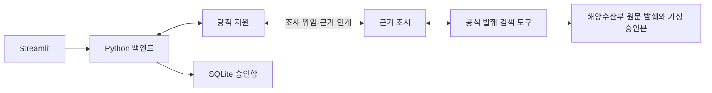

# 2에이전트 협업과 검증 사례

Streamlit에서 받은 해역, 기준시각(KST), 직전 가상 승인본 ID, 질문을 당직 지원 에이전트에 전달합니다. 공식 공개 자료에서 발췌해 보관한 과거 사례를 재현합니다.

- [근거 조사 배포 설정](../watsonx/gamak_research.yaml)은 보관 자료의 경보별 최신 발췌를 조회합니다. 기준시각과 같거나 이전에 공개·발효된 경보만 포함하며, 원문에 발령시각이 없으면 조회 가능시각을 기준으로 삼습니다.
- 근거 조사 에이전트는 `scope_status`, `approved`, `regional`, `government`를 인계합니다. `approved`에 해역·정부 경보 단계와 발령시각을 담습니다. 경보 발췌에는 `id`, `level`, `effective_at`, `text`를 담습니다.
- [당직 지원 배포 설정](../watsonx/gamak_supervisor.yaml)은 `decision`, `regional_citation`, `government_citation`을 반환합니다. 백엔드는 대화 이력의 위임·도구 기록과 보관 근거를 교차 검증합니다. 초안·확인 질문·승인함 상태는 백엔드가 결정합니다. 담당자가 최종 승인과 발송을 맡습니다.

## 검증 사례

| 사례 | 기준시각(KST) | 판정 | 승인함 |
| --- | --- | --- | --- |
| 같은 질문, 승인 직후 | 8/26 16:30 | 유지. `mof-62891-regional`, `mof-62891-government` | 0 → 0 |
| 같은 질문, 새 발표 후 | 8/29 16:30 | 갱신 필요. `mof-62990-regional`, `mof-62990-government` | 0 → 1 |
| 8/29 요청 반복 | 8/29 16:30 | 갱신 필요. 기존 초안 ID 재사용 | 1 → 1 |
| 일부 해역 해제 문의 | 8/30 10:00 | 확인 필요. 가막만 포함 여부를 묻고 초안 생성을 보류 | 1 → 1 |
| 현장 수온을 포함한 안내 요청 | 8/29 16:30 | 갱신 필요. 경보 변경을 쓰고 수온은 확인 필요로 표기 | 0 → 1 |

수온 사례는 별도의 빈 승인함에서 실행합니다. 다른 네 사례는 하나의 승인함에 순서대로 실행합니다. [검증용 JSON](../examples/two-agent-scenarios.json)에 입력, 인계, 판정, 초안 또는 확인 질문과 승인함 변화가 들어 있습니다.

- [근거 조사 프롬프트](../prompts/evidence-researcher-prompt.md)
- [당직 지원 프롬프트](../prompts/duty-support-prompt.md)
- [통합 프롬프트 JSON](../prompts/two-agent-prompts.json)
